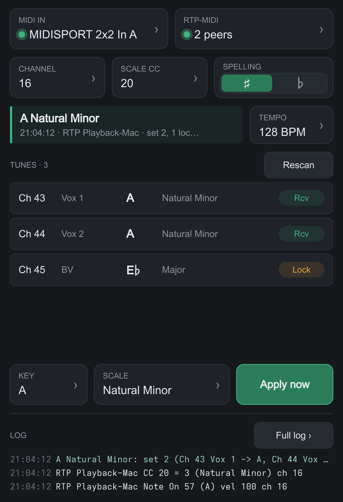
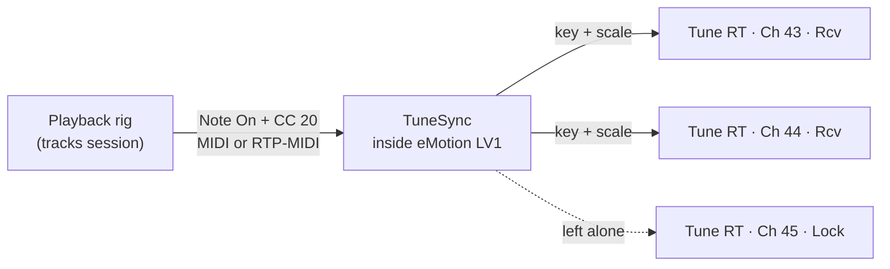
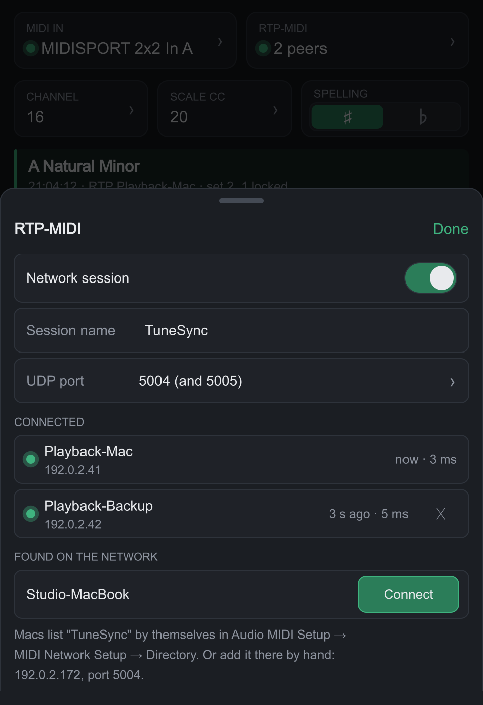

<p align="center">
  <picture>
    <source media="(prefers-color-scheme: dark)" srcset="assets/logo/tunesync-logo.svg">
    
  </picture>
</p>

<p align="center">
  <strong>Change the key of every Waves Tune Real-Time in eMotion LV1 with one MIDI note.</strong>
</p>

<p align="center">
  <a href="#license"></a>
  
  
  
</p>

---

In a live show the playback rig knows which song is playing; the pitch correction on the vocals
does not. TuneSync closes that gap. The tracks session sends one MIDI message at the top of each
song, and every instance of Waves Tune Real-Time in eMotion LV1 follows: same key, and optionally
the same scale. The key lives with the song in the tracks session, so reordering the set can
never leave the vocal tuning behind.

TuneSync runs inside LV1 as a control-surface module. It needs no extra application, no
snapshots and no Bonjour installation.

<p align="center">
  
</p>

## Features

- **One note, every Tune.** A Note On sets the key of every Tune RT on every input channel,
  group and FX return, including instances added during the show.
- **Scale by CC.** A control change (CC 20 by default) selects any of Tune's 11 scales.
- **Tempo too.** LV1's system tempo, which its tempo-synced plug-ins follow, follows the
  playback rig's MIDI clock, or is set exactly by a CC: the value is the BPM.
- **Respects Lock.** Instances switched to *Lock* on Tune's own Receive button are never touched.
- **Keeps the spelling.** A Tune showing E♭ stays a flat key; C♯ stays a sharp key.
- **Local or network MIDI.** Any MIDI input on the LV1 computer, opened by name and reopened
  when it comes back, and/or RTP-MIDI (AppleMIDI) with several rigs in one session, for
  example a main and a backup playback machine.
- **Finds Macs by itself.** TuneSync advertises itself through Windows' built-in DNS-SD, so it
  appears in macOS *Audio MIDI Setup → Network* without any setup on either side.
- **Verified changes.** Every change is read back from LV1 and reported in one log line, for
  example `A Natural Minor: set 2 (Ch 43 Vox 1, Ch 44 Vox 2), skipped 1 locked (Ch 45)`.
- **Never in LV1's way.** LV1's own threads never wait on MIDI, the network or the window.
  Measured on a show system during cues: LV1's UI thread stayed at a median of 1.7 ms.
- **Touch-first settings.** One page with large targets, built for the touchscreens LV1 hosts
  often use.

## How it works



Messages that arrive within 30 ms of each other are applied as one change, so a clip that sends
the scale CC and the key note together, or two rigs sending the same cue, produces a single pass
over the Tunes.

## Requirements

- Windows 10 or 11, 64-bit, or macOS 11 or later (Intel or Apple silicon)
- Waves eMotion LV1 (tested with 17.3.108 on Windows 11 and macOS 12; the control-surface
  interface is the same in 16.5)
- Waves Tune Real-Time in the session
- For network MIDI from a Mac: the Mac's network session (Audio MIDI Setup)

## Installation

Download the latest release from **[Releases](https://github.com/flaviusemil/tunesync-lv1/releases/latest)**:
`TuneSync-<version>-setup.exe` for Windows, `TuneSync-<version>-macos.zip` for macOS.

### Windows

1. Close eMotion LV1.
2. Run `TuneSync-<version>-setup.exe` as administrator. Keep *Add TuneSync to eMotion LV1's
   control surfaces* selected. The setup is not code-signed yet, so Windows SmartScreen may
   warn about an unknown publisher: choose *More info → Run anyway*.
3. Start LV1. TuneSync appears under **Setup → Control Surfaces**; its settings button opens
   the TuneSync window.

The setup installs `TuneSync_Control.dll` into LV1's `Modules` folder. Settings and the log are
kept in `%ProgramData%\TuneSync`. Uninstall from Windows Settings → Apps, with LV1 closed.

### macOS

1. Quit eMotion LV1 and unzip `TuneSync-<version>-macos.zip`.
2. Open Terminal in the unzipped folder (Finder: right-click the folder → *New Terminal at
   Folder*) and run `sudo ./install.sh`. It copies `TuneSync_Control.bundle` into
   `/Applications/Waves/eMotion LV1/Modules` and adds TuneSync to LV1's control surfaces
   (LV1's preferences are backed up first).
3. Start LV1. TuneSync appears under **Setup → Control Surfaces**.

Settings and the log are kept in `/Library/Application Support/TuneSync`. `sudo ./install.sh
--remove` takes TuneSync out again. The bundle is universal (Intel and Apple silicon) and
ad-hoc signed, not notarized; `install.sh` clears the download's quarantine flag.

In both, LV1 shows TuneSync's status beside it (**ON** in green when a MIDI input or a network
peer is connected, **N/A** in red when not) and its own picture in **Setup → System Inventory**.

## Usage

Send these on the configured MIDI channel (16 by default) at the top of each song:

| Message | Effect |
|---|---|
| Note On, any octave, velocity above 0 | Key = the note's pitch class |
| CC 20, value 0–10 | Scale (table below); other values are ignored and logged |
| CC 21, value 40–127 | LV1's tempo = the value in BPM, for example 56 = 56 BPM |
| CC 22, value 0–127 | LV1's tempo = 100 + the value, for faster songs: 28 = 128 BPM |

| Value | Scale | Value | Scale |
|---|---|---|---|
| 1 | Chromatic | 6 | Melodic Minor (Asc+Dec) |
| 2 | Major | 7 | Major Justonic |
| 3 | Natural Minor | 8 | Minor Justonic |
| 4 | Harmonic Minor | 9 | Dorian |
| 5 | Melodic Minor (Asc) | 10 | Mixolydian |
| 0 | User Scale | | |

A note without a CC changes only the key. Both the channel and the CC number can be changed in
the settings window, which also offers **Apply now** for checking the setup at soundcheck.

> **Tip:** controller buttons that send CC 20 = 127 when pressed and 0 when released select
> *User Scale* on release. Configure the button to send the scale's own number instead.

**Tempo.** TuneSync also follows MIDI clock from the playback rig, on any channel. LV1's tempo
(the Top Bar BPM, which LV1's tempo-synced plug-ins follow) is set once the clock has been
steady for about two beats, and again whenever the clock's tempo changes by half a BPM or more.
Over RTP-MIDI the clock is timed on the sending computer's own timestamps, so Wi-Fi jitter does
not reach the tempo. When a main and a backup rig both send clock, the first one is followed. A
tempo set by CC holds until the clock's tempo changes or the clock starts again. Apps that
send no clock (Loop Community's Prime, for example) set the tempo with CC 21 or CC 22 in each
song's start cue, next to the key note and the scale CC.

### Connecting a Mac over the network

1. In the TuneSync window, open **RTP-MIDI** and switch the network session on.
2. On the Mac, open **Audio MIDI Setup → Window → Show MIDI Studio**, then the **Network** icon.
3. *TuneSync* is listed under **Directory**. Select it and click **Connect**. Use the Mac's
   session as the MIDI output of the tracks session.

TuneSync can also invite a Mac itself: Macs that publish a network session are listed in the
RTP-MIDI sheet under *Found on the network*. Typing the PC's address and the port the RTP-MIDI
sheet shows on the Mac works as well. The port is 5004 unless another RTP-MIDI session already
holds it (macOS's own network session, rtpMIDI on Windows); TuneSync then moves up to the next
free pair (5006, 5008, ...) by itself.

<p align="center">
  
</p>

## Building from source

Everything builds on Linux in Docker; nothing else needs to be installed.

```sh
# Once: a base image with LLVM and Microsoft's CRT and Windows SDK (fetched by xwin).
# Building it accepts Microsoft's licence for those files; read it first.
docker build -t tunesync-xwin:1 -f tools/docker/xwin.Dockerfile tools/docker
docker build -t tunesync-build:1 tools/docker

tools/cargo.sh test --workspace     # all tests
tools/build-dll.sh                  # dist/TuneSync_Control.dll
tools/wine/run-sim.sh               # the DLL against a simulated LV1, under Wine
tools/make-installer.sh             # dist/TuneSync-<version>-setup.exe

# macOS, no Mac needed: Apple's Rust targets and a stub-based linker (tools/mac/cc.sh).
docker build -t tunesync-mac:1 -f tools/docker/mac.Dockerfile tools/docker
tools/build-mac.sh                  # dist/mac/TuneSync_Control.bundle and the macOS zip
MAC=user@host tools/mac/run-sim.sh  # the bundle against a simulated LV1, on a Mac
```

`tools/wine/run-sim.sh` loads the DLL the way LV1 does, against a fake mixer core with three
Tune instances, and drives it end to end: interface checks, an RTP-MIDI cue, Lock, and teardown.

### Project layout

| Crate | Purpose |
|---|---|
| [`crates/tunesync`](crates/tunesync) | The library: Tune tables and spelling, MIDI interpretation, discovery and apply against a `Mixer` trait, settings, log. No LV1 or OS code, so it can be embedded elsewhere. |
| [`crates/rtpmidi`](crates/rtpmidi) | RTP-MIDI / AppleMIDI: codec and a session several peers can join. |
| [`crates/host`](crates/host) | The runtime: worker threads, MIDI input by name, the RTP-MIDI service and DNS-SD, settings and log files. |
| [`crates/lv1-surface`](crates/lv1-surface) | eMotion LV1's control-surface driver interface in Rust: the ABI, the exported entry points and guarded calls into LV1. |
| [`crates/ui`](crates/ui) | The settings window as a portable view model, with an SVG renderer for previews and tests. |
| [`crates/control`](crates/control) | `TuneSync_Control.dll` / `TuneSync_Control.bundle`, the thin module LV1 loads, with the Direct2D (Windows) and AppKit (macOS) window. |
| [`crates/capi`](crates/capi) | TuneSync as a C library (`include/tunesync.h`, static or shared) for a C or C++ host. |
| [`crates/sim`](crates/sim) | A simulated LV1 for testing the DLL (and, on a Mac, the bundle) without LV1. |

The design and its decisions are documented in [docs/DESIGN.md](docs/DESIGN.md).

## Status

TuneSync 0.1 has been tested on a live LV1 system (LV1 17.3.108, Windows 11): RTP-MIDI and
local MIDI cues, Lock, tempo by CC, the settings window, LV1's responsiveness, the status and
picture in LV1's surface list, and a Mac, an iPad and an iPhone joining over a real network in
both directions. The macOS version has been tested in LV1 17.3.108 on macOS 12 (Intel): loading,
RTP-MIDI from an iPad and tempo by CC; its Apple silicon half is built but not yet tried on
hardware. Still to be verified: the stereo Tune instance.

The library is also available as a C API ([`crates/capi`](crates/capi)) for embedding in other
hosts.

## License

TuneSync is licensed under either of

- [Apache License, Version 2.0](LICENSE-APACHE)
- [MIT license](LICENSE-MIT)

at your option. Unless you explicitly state otherwise, any contribution you submit for inclusion
in TuneSync, as defined in the Apache-2.0 license, shall be dual licensed as above, without any
additional terms or conditions.

TuneSync is an independent project. It is not affiliated with, endorsed by or supported by Waves
Audio Ltd. eMotion LV1, Tune Real-Time and SoundGrid are trademarks of their respective owners.
TuneSync communicates with LV1 through its control-surface driver interface, which was studied
for interoperability.
